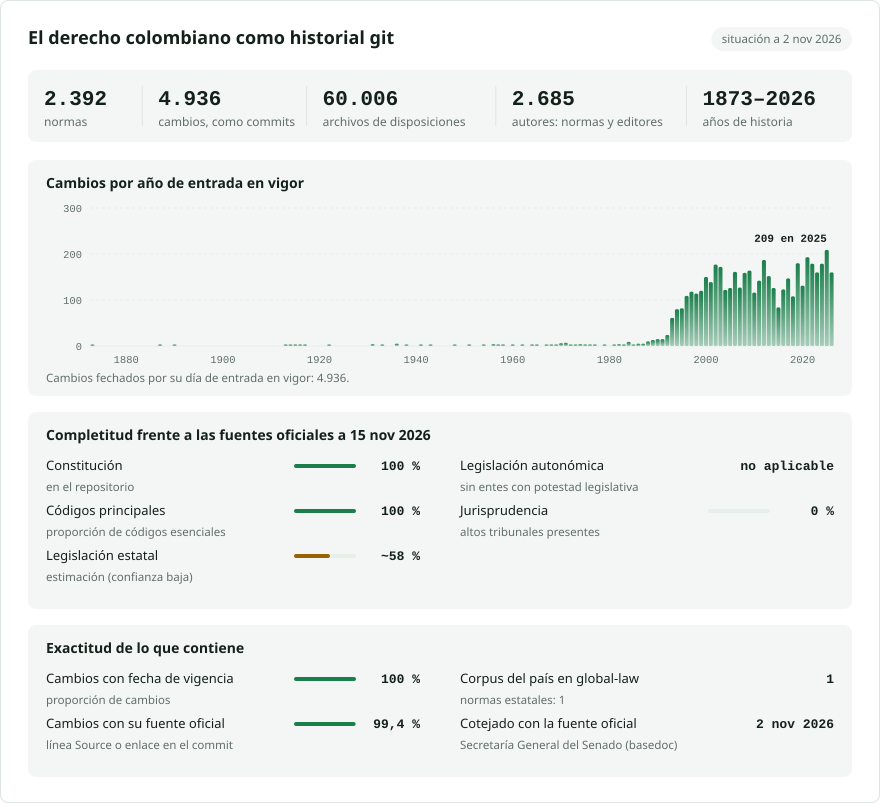

# Colombia: historia del derecho en git

**Español** · [English](README.en.md)

<picture>
<source media="(prefers-color-scheme: dark)" srcset="data/es/effort-dark.svg">

</picture>

El derecho nacional de Colombia como historia de git: un archivo por artículo, un commit por ley o sentencia el día en que entró en vigencia, y la norma o la sentencia que hizo cada cambio como autor del commit. `git blame` indica la ley o la sentencia que está detrás de cada párrafo; `git log` enumera todos los cambios de un artículo; al elegir una fecha se obtiene el texto vigente ese día.

Forma parte de [lexifina/global-law](https://github.com/lexifina/global-law), una única historia de git para el derecho de todos los países: este es el derecho nacional de Colombia, que global-law lee en `colombia/national/acts/`.

**Qué contiene ahora:** 2.392 normas con 6.166 versiones desde 1873: la Constitución de 1991, con los 63 Actos Legislativos y las sentencias que la modificaron, y 2.354 leyes y 37 decretos, entre ellos 34 códigos. 1.958 de las normas parten del texto más antiguo que publica la fuente, no de su expedición; 18 fueron derogadas después, y su historia termina con una versión sin disposiciones; 9 versiones, que entrarán en vigencia después del 2 de noviembre de 2026, están en la rama `futuro`. [`data/versions.json`](data/versions.json) enumera cada norma con el día en que entró en vigencia cada versión; [`data/laws.csv`](data/laws.csv) enumera las 2.692 leyes, decretos y sentencias que están detrás de los cambios, con sus fechas.

Cada norma es una carpeta, por lo general `<kind>/<year>/<number>/` (`ley/2002/789/` es la Ley 789 de 2002); la Constitución está en `constitution/constitucion/` y 25 códigos están en `code/` (`code/codigo-sustantivo-del-trabajo/` es el Código Sustantivo del Trabajo). Cada artículo es un archivo (`art-0161.md`), los encabezados de libros, títulos y capítulos están en `titulos.md`, y 197 normas son un solo archivo, `texto.md`. [`data/paths.json`](data/paths.json) relaciona el identificador de cada norma con su carpeta.

El texto está en español, tal como lo publica la basedoc del Senado, sin las notas editoriales ni las concordancias de Avance Jurídico, que prepara esa compilación. Este registro no incluye una traducción al inglés.

## Preguntas como comandos de git

| Pregunta | Comando |
| --- | --- |
| Todos los cambios del art. 161 del Código Sustantivo del Trabajo | `git log -p --word-diff --follow -- code/codigo-sustantivo-del-trabajo/art-0161.md` |
| ¿Qué ley escribió cada línea del art. 161? | `git blame code/codigo-sustantivo-del-trabajo/art-0161.md` |
| Todas las versiones del Código Sustantivo del Trabajo, con el día en que entró en vigencia cada una | `git log --diff-filter=r --format="%h %(trailers:key=In-force,valueonly,separator=) %an" -- code/codigo-sustantivo-del-trabajo codigo-sustantivo-del-trabajo ":^*/README.md"` |
| El art. 161 vigente al 1 de enero de 2020 | `python tools/on.py 2020-01-01 code/codigo-sustantivo-del-trabajo art-0161` |

El 2026-11-10 las normas pasaron a sus carpetas actuales: `--follow` y el nombre anterior de la carpeta (`codigo-sustantivo-del-trabajo`) alcanzan la historia anterior al traslado, y `--diff-filter=r` deja fuera el propio traslado.

**Fuera de git**, también alojamos este registro de forma pública y gratuita:

- **[Preguntar a Claude sobre el derecho colombiano](https://global-law.lexifina.com/v1/try_claude?country=colombia)**: abre Claude con una primera pregunta preparada.
- **[Preguntar a ChatGPT](https://global-law.lexifina.com/v1/try_chatgpt?country=colombia)**: la misma pregunta en ChatGPT.
- **[Buscar en el derecho colombiano en nuestro sitio](https://lexifina.com/law?country=colombia&q=vacaciones+anuales)**: una búsqueda de "vacaciones anuales", con el texto de cada disposición y sus versiones, sin necesidad de cuenta.
- **[API REST para desarrolladores](https://global-law.lexifina.com/v1/search_law?query=vacaciones+anuales&jurisdiction=colombia)**: la misma búsqueda en JSON, sin clave. Consulte la [documentación aquí](https://lexifina.com/api/global-law).

Ambos asistentes leen el registro a través del conector gratuito Global law (MCP, `https://global-law.lexifina.com/mcp`); la primera vez, el chat le da el enlace para agregarlo. Pregunte en español o en inglés.

**Alójelo usted mismo fácilmente.** Solo hacen falta git y Python, y las herramientas se ejecutan en su equipo:

```sh
git clone --depth 1 https://github.com/lexifina/global-law && cd global-law
python3 tools/countries.py add colombia/national/acts
python3 tools/law.py show 2026-01-01 colombia/national/acts/code/codigo-sustantivo-del-trabajo/art-0161.md
```

Abierto en Claude Code, Cursor, VS Code o Codex, el clon también inicia un servidor MCP local con las mismas herramientas ([MCP.md](https://github.com/lexifina/global-law/blob/main/MCP.md)).

## Fechas

Cada commit está fechado a las doce del mediodía, hora de America/Bogota, del día en que el cambio entró en vigencia, y lleva ese día en su trailer `In-force:`, junto a `Enacted:` y `Published:`:

- decide la cláusula de vigencia de la propia ley; a falta de ella, la Ley 4 de 1913 (Código de Régimen Político y Municipal), arts. 52 y 53, la sitúa dos meses después de su promulgación. Los Actos Legislativos rigen desde su publicación en el Diario Oficial, salvo que fijen otro día (tres de ellos, un día de elecciones, tomado de la Registraduría);
- una sentencia que declara inexequible un texto surte efectos desde el día de la sentencia, salvo que la Corte disponga otra cosa (Ley 270 de 1996, art. 45);
- una norma que parte de su texto más antiguo disponible comienza el día más reciente que las notas de la fuente dan para ese texto o, a falta de esas notas, el día en que comienza la propia norma;
- git no puede almacenar fechas anteriores a 1970, por lo que los 47 commits anteriores están fechados a partir del 1970-01-01, con un segundo de diferencia entre sí, y llevan el día real en `In-force:`. Para consultar una fecha, use `tools/on.py`, no `git log --before`.

Cada cambio se atribuye a la ley, el decreto, el Acto Legislativo o la sentencia que lo hizo, con una dirección que no puede existir (`Ley 2466 de 2025 <ley-2466-2025@secretariasenado.invalid>`, `Sentencia C-081 de 2026`), de modo que `git blame` y `git log --author` indican leyes y sentencias. El texto más antiguo disponible de una norma se atribuye a quien lo publica, `Secretaría General del Senado (basedoc)`, como "versión más antigua disponible"; el committer es Lexifina.

## Cómo se verifica

- `tools/check_repo.py` vuelve a leer desde git cada versión el día en que entró en vigencia y el día anterior, y la compara, archivo por archivo, con el corpus cuyo sha256 está en `data/corpus.sha256`; también verifica que los trailers de todos los commits se analicen sin errores, que `main` no tenga commits de fusión (merge) y que nada esté fechado en el futuro.
- `tools/verify.py` compara la última versión de cada norma en el corpus con el texto actual de la página de la basedoc, sin las marcas editoriales ni las palabras tachadas.
- El mismo corpus produce los mismos hashes de commit (`tools/build.py`). [`REPRODUCE.md`](REPRODUCE.md) todavía no registra ningún resultado de estas verificaciones para la compilación actual, ni ninguna segunda compilación comparada.
- La historia solo admite agregados (`tools/append.py`): las normas nuevas y las versiones posteriores se añaden encima, y ningún commit publicado se reescribe.
- [vulnerabilities/](vulnerabilities/): posibles errores de técnica normativa en el derecho colombiano, hallados por los detectores de global-law y comprobados a mano.

## Qué no muestra

- **La mayoría de los decretos y el derecho más antiguo.** Solo están aquí 37 decretos (17 de ellos, códigos y estatutos) y, además de la Constitución, 18 normas anteriores a 1992; no están los decretos reglamentarios, las resoluciones ni el derecho departamental y municipal.
- **Los cambios anteriores al texto más antiguo disponible de una norma.** Para 1.958 normas la fuente no da ningún texto anterior, por lo que sus cambios anteriores quedan dentro de ese primer commit.
- **La jurisprudencia**, salvo las sentencias que modificaron un texto: 1.400 de la Corte Constitucional, y algunas de la Corte Suprema de Justicia y del Consejo de Estado, son commits; las sentencias mismas no están aquí.
- **Los cambios que no tocan el texto.** 481 commits no cambian ninguna palabra (`Words-changed: no`), en su mayoría sentencias que declararon un texto exequible de forma condicionada; no tocan ningún archivo, por lo que el historial (log) de una ruta no los muestra.
- **Algunos textos anteriores.** Cuando la fuente indica la norma que modificó una disposición pero no publica ningún texto posterior a ella, la disposición dice `[La fuente no da el texto vigente en esta fecha.]` durante ese período (5 disposiciones hoy).

## Fuentes

| Fuente | Tipo | Versiones anteriores | Notas |
| --- | --- | --- | --- |
| [Secretaría General del Senado, basedoc](http://www.secretariasenado.gov.co/senado/basedoc/) | Compilación oficial de la Constitución, los códigos y las leyes, preparada por Avance Jurídico | sí, para muchas disposiciones: sus textos anteriores y una nota sobre cada cambio | El texto de todas las normas; sus notas indican la norma o la sentencia detrás de cada cambio, con los números y las fechas del Diario Oficial |
| [Colpensiones, Normativa](https://normativa.colpensiones.gov.co/colpens/) | Compilación de normas antiguas | no corresponde | Encabezados y cláusulas de vigencia de normas anteriores a 1992 que faltan en la basedoc |
| [Régimen Legal de Bogotá](https://www.alcaldiabogota.gov.co/sisjur/), [DIAN, Compilación Jurídica](https://normograma.dian.gov.co/) | Compilaciones oficiales | no corresponde | El día de entrada en vigencia de tres decretos que faltan en la basedoc |
| Registraduría Nacional del Estado Civil | Autoridad electoral | no corresponde | Los días de tres elecciones en los que entraron en vigencia Actos Legislativos |

## Licencia

Véase [`LICENSE`](LICENSE). Según la Ley 23 de 1982, art. 41, la Constitución, las leyes, los decretos y las decisiones judiciales pueden reproducirse libremente, siempre que se reproduzca fielmente el texto oficial; no se reproducen las notas, concordancias ni comentarios de Avance Jurídico, sino solo el texto oficial y los hechos que sus notas consignan. Las contribuciones propias de Lexifina (la organización, los mensajes de commit, las tablas y las herramientas) son CC0 1.0.

Ningún modelo de IA escribió, tradujo ni corrigió texto normativo, y ninguno se ejecuta durante la compilación; los scripts los escribió Claude Code con Claude Opus 5.5 (véase [`REPRODUCE.md`](REPRODUCE.md)).

Esta es una traducción de la versión inglesa ([README.en.md](README.en.md)); si difieren, prevalece la versión inglesa.

## Más información

Del repositorio [lexifina/global-law](https://github.com/lexifina/global-law) (páginas en inglés):

- [FEATURES.md](https://github.com/lexifina/global-law/blob/main/FEATURES.md): todas las funciones y lo que cada corpus debe admitir (`git blame`, `law.py`, herramientas MCP)
- [FAQ.md](https://github.com/lexifina/global-law/blob/main/FAQ.md): preguntas y respuestas · [CONTRIBUTING.md](https://github.com/lexifina/global-law/blob/main/CONTRIBUTING.md): proponer cambios · [MCP.md](https://github.com/lexifina/global-law/blob/main/MCP.md): servidor MCP · [REPRODUCE.md](https://github.com/lexifina/global-law/blob/main/REPRODUCE.md): cómo se ha construido · [CHANGELOG.md](https://github.com/lexifina/global-law/blob/main/CHANGELOG.md)
- [FRESHNESS.md](https://github.com/lexifina/global-law/blob/main/FRESHNESS.md): lo actualizado que está cada corpus · [Supervisión](https://github.com/lexifina/global-law/tree/main/monitoring): si las actualizaciones funcionan · [WATCHING.md](https://github.com/lexifina/global-law/blob/main/WATCHING.md): cómo se vigila cada fuente oficial para detectar cambios
- [performance/](https://github.com/lexifina/global-law/tree/main/performance): la rapidez de las herramientas, medida
- [visualisations/](https://github.com/lexifina/global-law/tree/main/visualisations): gráficos y conexiones a través del derecho de todo el mundo
- [Vulnerabilidades](https://github.com/lexifina/global-law/tree/main/vulnerabilities): errores en las normas tal como se publicaron
