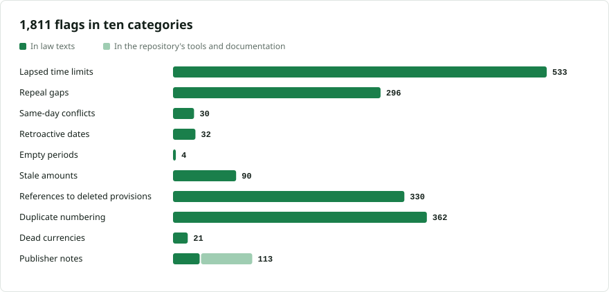

# Vulnerabilities in Colombian law

[Español](README.md) · **English**

<picture>
<source media="(prefers-color-scheme: dark)" srcset="img/flags-by-category-dark.svg">

</picture>

The vulnerability detectors from [lexifina/global-law](https://github.com/lexifina/global-law/tree/main/vulnerabilities) look for mechanical mistakes in legislation: a rule applying "until" a date that has passed, a time limit extended only after it had run out, a provision repealed before its replacement took effect, an amount changed in one place but not in another, a reference to an article that no longer exists. global-law's published list (9 November 2026) covered Colombia with 225 flags from an earlier copy of this repository: 138 repeal gaps, 22 retroactive dates, 21 stale amounts, 19 references to deleted provisions, 18 lapsed time limits, 3 dead currencies, 3 publisher notes (listed there as failed amendments) and 1 empty period. This is a run over this repository only, as it stood at commit [`4f8d104`](https://github.com/lexifina/colombia-law/commit/4f8d1041e0cde7d6f171d26e5606e50e94c1a6e3) on 16 November 2026, with its whole history and with the Constitutional Court rulings that struck out text counted as changes to the law. It also finds two categories that list did not have for Colombia: same-day conflicts (30) and duplicate numbering (362).

**In short:** the detectors raised 1,811 flags. A language model reviewed 226 of the strongest, arguing each one for and against; 44 survived. Checked by hand in this repository, one of them looks like a real slip in Colombian law, if a minor one: paragraph 3 of Article 74-1 of the Tax Statute (Estatuto Tributario) still excludes from its rules the research, development and innovation projects "that opt for what Articles 158-1 and 256 provide", although Law 2277 of 2022 (Art. 96) repealed Article 158-1 from 13 December 2022 without amending Article 74-1. Another is a real gap, but one the legislature acknowledged: the paragraph of Article 100 of Law 1438 of 2011 let health providers seeking accreditation draw on the university-hospital stamp levy "until 31 December 2021"; Law 2333 of 2023 moved the date to 2026 only from 25 September 2023, and itself guarantees the "retroactivity" of the funds not paid "during the period in which it lapsed". Of the other 42, 22 come from how this repository builds and dates its record (two of them from a build error described below), 5 are misreadings by the detector, 13 are lawful, 1 is a reference to repealed articles that the repealing act itself replaces, and 1 is spent. The model does not review three categories; reading them turned up no further mistake. Later, this will be formalised in Lean, similar to our work on [the US tax code](https://lexifina.com/blog/formalizing-the-us-tax-code) and [US case law](https://lexifina.com/blog/formalizing-all-us-case-law-in-lean).

A flag is a prompt to look, not legal advice, and nothing here has been tested in court.

## Flags by category

| Category | What it looks for | Flags | In law texts | Reviewed | Survived review |
| --- | --- | ---: | ---: | ---: | ---: |
| Lapsed time limits | Text still applying a rule "until" a date that has passed | 533 | 533 | 40 | 1 |
| Repeal gaps | A provision removed before its replacement took effect | 296 | 296 | 40 | 7 |
| Same-day conflicts | Two acts changing the same provision on the same day | 30 | 30 | 30 | 5 |
| Retroactive or pre-publication dates | A rule in force before it was published in the Diario Oficial | 32 | 32 | 32 | 8 |
| Empty periods | A time limit extended by an act that took effect after it had run out | 4 | 4 | 4 | 3 |
| Stale amounts | An amount changed in one place but still standing elsewhere | 90 | 90 | 40 | 13 |
| References to deleted provisions | A provision citing an article that no longer exists | 330 | 330 | 40 | 7 |
| Duplicate numbering | Two units with the same number in one act | 362 | 362 | 0 | 0 |
| Dead currencies | Amounts in currencies no longer in use | 21 | 21 | 0 | 0 |
| Publisher notes | The source's own "(sic)" and similar notes | 113 | 38 | 0 | 0 |

"In law texts" counts every file in the folders of acts: the Constitution and its Legislative Acts, the codes, the laws and the decrees (`constitution/`, `code/`, `ley/`, `decreto/`, `act/` and the other folders of acts). The other 75 flags are in the English comments of the repository's build scripts (`tools/`, 71) and in [`REPRODUCE.md`](../REPRODUCE.md) (4): almost all are the phrase "two paragraphs", which the publisher-note search takes for a note flagging two paragraphs with the same number. The search for lapsed time limits now also reads dates with the day as an ordinal ("1o de enero", "1o. de julio"), the day or the year in words with the figure in brackets ("hasta el treinta y uno (31) de diciembre de dos mil cinco (2005)") and deadlines "a más tardar el 31 de diciembre de 2020" (no later than): 311 flags became 533, 154 of them deadlines, and the empty-period detector, which reads the same dates but not deadlines, found 4 where it had found 2. It still leaves out 57 phrases that give only a year ("hasta el año 2020", "hasta diciembre de 2020", "hasta la vigencia fiscal 2020"), 50 of them past. A repealed article disappears from its folder here, leaving no file that reads "repealed", so a reference to it counts as a reference to a deleted provision; the search for references to repealed placeholders found nothing, and neither did the search for dead fines.

*Edge cases: the 44 flags that survived the review, grouped by what they turned out to be, and what the other flags are, in [EDGE-CASES.en.md](EDGE-CASES.en.md).*

## Problems found in this repository

- **Whole articles removed where the Court struck out only part:** where a ruling declared part of an article's original text unconstitutional and a law later amended the article, the record removes the whole file from the ruling until the amending law. So it is in all five such cases checked against the basedoc, all in the [Code of Criminal Procedure](https://github.com/lexifina/colombia-law/blob/4f8d1041e0cde7d6f171d26e5606e50e94c1a6e3/code/codigo-de-procedimiento-penal/art-0331.md) (Law 906 of 2004): Article 331, from which Ruling C-591 of 2005 struck only the words "a partir de la formulación de la imputación", is missing from 9 June 2005 to 11 July 2025 ([the change](https://github.com/lexifina/colombia-law/commit/49570893e47d2c0d9f02ba0f3bb9e55a51644399)); Article 102, from which Ruling C-516 of 2007 struck only the second paragraph, is missing from 11 July 2007 to 12 July 2010 ([the change](https://github.com/lexifina/colombia-law/commit/75bbdd9fcd0924c1939e7ea196b40faac1de97d4)); and Articles 2 (Ruling C-730 of 2005), 230 (C-519 of 2007, numeral 4 only) and 314 (C-154 of 2007, parts of numeral 5 only) are missing until Laws 1142 of 2007 and 1453 of 2011. A reader of the text on a date in those periods does not find the article, though it stayed in force without the words struck out. 52 repeal gaps begin with a ruling and end with a law. Besides those five, one more was checked, Article 400A of the Criminal Code, which was rightly removed: Ruling C-302 of 2010 struck down the whole of Decree 126 of 2010, which had added it; the other 46 have not been checked.
- **Acts outside their `<kind>/<year>/<number>/` folder:** the folder move of 10 November 2026 read backwards the id of 322 laws whose number looks like a year (Law 1600 of 2012 to Law 2029 of 2020), which ended up in `ley/<number>/<year>/` ([`ley/1722/2014/`](https://github.com/lexifina/colombia-law/tree/4f8d1041e0cde7d6f171d26e5606e50e94c1a6e3/ley/1722/2014) is Law 1722 of 2014), and took the name of twelve others for a kind of act: the six National Development Plans are in `plan-nacional-de-desarrollo/<first year>/<last year>/` (`plan-nacional-de-desarrollo/2006/2010/` is Law 1151 of 2007), the five extensions of Law 418 of 1997 in `prorroga-de-la-ley/<year>/418/` (`prorroga-de-la-ley/1999/418/` is Law 548 of 1999) and Law 1949 of 2019 in `reforma-leyes/2019/1122-y-1438/`. [`data/paths.json`](../data/paths.json) lists these folders, so the tools find them, but a reader looking for `ley/2014/1722/` does not.
- **A change dated before it took effect:** Decree 1819 of 1964, whose Article 6 rewrote the jurisdiction of the municipal labour judges (Article 12 of the Code of Labour Procedure, through Article 9 of Decree 528 of 1964), provides in its Article 18 that it applies from 1 July 1965, except its Articles 10 and 11; the record applies it from its issue on 17 July 1964 ([the change](https://github.com/lexifina/colombia-law/commit/01aa08163052e69488f8fb773f846d5fdf472911)), and leaves the amending instruction ("El artículo 9o del Decreto 528 de 1964, quedará así:") in the article's text until 1977.

## Files

| File | What it holds |
| --- | --- |
| [data/flags.csv](data/flags.csv) | Every flag, one row per provision and issue |
| [data/reviewed.csv](data/reviewed.csv) | The 226 flags the model reviewed, with its verdict and reason |
| [data/by_category.csv](data/by_category.csv) | The counts in the table above |
| [tools/](tools/) | The scripts that made this run |

Columns: `category` and `category_es` (the category in English and Spanish), `detector`, `kind` (`law` or `other`), `path` (the file in this repository; empty for a retroactive date, which names the act), `date` (the date the flag turns on), `reference` (the act or line involved), `summary`, `score` (the detector's ranking, 0 to 1), `review` (`artefact`, `lawful` or `candidate_defect`), `survives_rebuttal`, `review_note` (the model's reason, in English), `url` (the provision at the commit that was read or, if it was deleted earlier, at the last commit that held it; for a retroactive date, the commit that made the act's version on that day).

## How it was made

- **Detectors:** global-law's [vulnerabilities/scripts](https://github.com/lexifina/global-law/tree/main/vulnerabilities/scripts), run on this repository at commit `4f8d104`. global-law replays this repository only up to an earlier commit, so the history table the detectors read was built from this repository's own commits (the act or ruling that made each change, its `In-force` date and its `Kind`; laws, decrees, rulings and oldest available versions count as law, documentation is left out), with the paths from before the folder move of 10 November 2026 mapped to each act's folder today. The detectors carry the fixes global-law's scripts received in the runs on other country repositories, and one for Colombian Spanish: the date forms above.
- **Model review:** gpt-5.4-mini, the 40 strongest flags per category (all of them in the smaller categories); one pass says whether a flag is real, a second argues that it is not. Empty periods use global-law's own review for that category, on all 4 flags, followed by the same second pass. The model does not review duplicate numbering, dead currencies or publisher notes. global-law's own list used a different model.
- **Hand check:** every flag that survived was read in this repository's history and texts, and in the extending, repealing or citing act where this repository holds it. In the Senate's basedoc, the notes on Articles 2, 102, 230, 314 and 331 of the Code of Criminal Procedure, Article 400A of the Criminal Code, Article 67 of the Code of Criminal Procedure of 2000, Article 13 of Law 42 of 1993 and Law 619 of 2000 were read, and the commencement clause of Law 276 of 1996; in Colpensiones' Normativa, the commencement clauses of Decrees 616 of 1954, 3129 of 1956 and 1819 of 1964 and of Laws 16 of 1969 and 27 of 1974, which this repository does not hold. The dead currencies, duplicate numbers and publisher notes were read by the words matched.

To report a correction, open an issue with the provision and an official source.

## Licence

The lists and notes are Lexifina's, dedicated to the public domain under CC0 1.0, like the rest of this repository's own contributions. Quoted law text is official text of the Republic of Colombia as the Senate's Secretaría General publishes it in its basedoc; under Law 23 of 1982, Art. 41, the Constitution, laws, decrees and judicial decisions may be reproduced freely, provided the official text is reproduced faithfully. The notes, concordances and commentary of Avance Jurídico are not reproduced, only the facts they state. See [LICENSE](../LICENSE).
