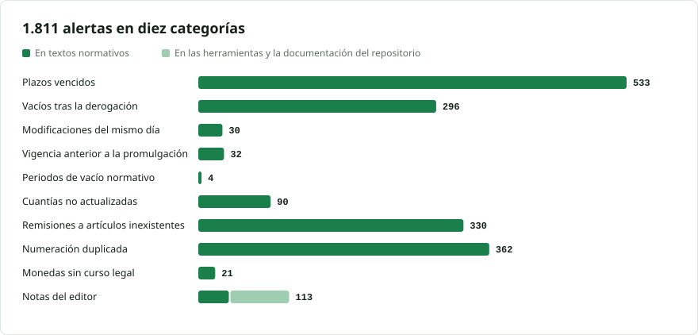

# Vulnerabilidades en el derecho colombiano

**Español** · [English](README.en.md)

<picture>
<source media="(prefers-color-scheme: dark)" srcset="img/flags-by-category-dark.es.svg">

</picture>

Los detectores de vulnerabilidades de [lexifina/global-law](https://github.com/lexifina/global-law/tree/main/vulnerabilities) buscan errores mecánicos en la legislación: una regla que sigue aplicándose «hasta» una fecha ya pasada, un plazo prorrogado cuando ya había vencido, una disposición derogada antes de que rigiera la que la sustituye, una cuantía modificada en un lugar pero no en otro, una remisión a un artículo que ya no existe. La lista que global-law publicó el 9 de noviembre de 2026 incluía Colombia con 225 alertas, obtenidas de una copia anterior de este repositorio: 138 vacíos tras la derogación, 22 vigencias anteriores a la promulgación, 21 cuantías no actualizadas, 19 remisiones a disposiciones inexistentes, 18 plazos vencidos, 3 monedas sin curso legal, 3 notas del editor (allí llamadas modificaciones fallidas) y 1 periodo de vacío normativo. Esta es una revisión de este repositorio solamente, en el estado del commit [`4f8d104`](https://github.com/lexifina/colombia-law/commit/4f8d1041e0cde7d6f171d26e5606e50e94c1a6e3) de 16 de noviembre de 2026, con toda su historia y con las sentencias de la Corte Constitucional que retiraron texto contadas como cambios del derecho. Halla además dos categorías que esa lista no tenía para Colombia: modificaciones del mismo día (30) y numeración duplicada (362).

**En resumen:** los detectores generaron 1.811 alertas. Un modelo de lenguaje revisó las 226 más sólidas, con argumentos a favor y en contra de cada una; 44 resistieron. Comprobada a mano en este repositorio, una de ellas parece un descuido real del derecho colombiano, aunque de efecto menor: el numeral 3 del artículo 74-1 del Estatuto Tributario sigue excluyendo de su régimen los proyectos de investigación, desarrollo e innovación «que opten por lo previsto en el artículo 158-1 y 256», pese a que la Ley 2277 de 2022 (art. 96) derogó el artículo 158-1 desde el 13 de diciembre de 2022 sin modificar el 74-1. Otra es un vacío real, pero reconocido por el legislador: el parágrafo del artículo 100 de la Ley 1438 de 2011 permitía a las instituciones prestadoras de salud en proceso de acreditación acceder a los recursos de la estampilla pro hospital universitario «hasta el 31 de diciembre de 2021»; la Ley 2333 de 2023 llevó la fecha a 2026 solo desde el 25 de septiembre de 2023, y ella misma garantiza la «retroactividad» de los recursos no pagados «durante el periodo de pérdida de vigencia». De las otras 42, 22 se explican por cómo este repositorio construye y data su registro (dos de ellas, por un error de compilación que se describe más abajo), 5 son lecturas erróneas del detector, 13 son conformes a derecho, 1 es una remisión a artículos derogados que la propia ley derogatoria suple y 1 es una regla agotada. El modelo no revisa tres categorías; su lectura no arrojó ningún error más. Más adelante se formalizará en Lean, como nuestro trabajo sobre [el código tributario de EE. UU.](https://lexifina.com/blog/formalizing-the-us-tax-code) y [la jurisprudencia de EE. UU.](https://lexifina.com/blog/formalizing-all-us-case-law-in-lean).

Una alerta es una invitación a examinar el texto, no un asesoramiento jurídico, y nada de lo aquí expuesto se ha sometido a un juez.

## Alertas por categoría

| Categoría | Qué busca | Alertas | En textos normativos | Revisadas | Resistieron la revisión |
| --- | --- | ---: | ---: | ---: | ---: |
| Plazos vencidos | Un texto que sigue aplicando una regla «hasta» una fecha ya pasada | 533 | 533 | 40 | 1 |
| Vacíos tras la derogación | Una disposición retirada antes de que rigiera la que la sustituye | 296 | 296 | 40 | 7 |
| Modificaciones del mismo día | Dos normas que modifican la misma disposición el mismo día | 30 | 30 | 30 | 5 |
| Vigencia anterior a la promulgación | Una regla en vigor antes de su publicación en el Diario Oficial | 32 | 32 | 32 | 8 |
| Periodos de vacío normativo | Un plazo prorrogado por una norma que entró en vigencia cuando ya había vencido | 4 | 4 | 4 | 3 |
| Cuantías no actualizadas | Una cuantía modificada en un lugar que sigue figurando en otro | 90 | 90 | 40 | 13 |
| Remisiones a disposiciones inexistentes | Una disposición que remite a un artículo que ya no existe | 330 | 330 | 40 | 7 |
| Numeración duplicada | Dos divisiones con el mismo número en una norma | 362 | 362 | 0 | 0 |
| Monedas sin curso legal | Cuantías en monedas que ya no se usan | 21 | 21 | 0 | 0 |
| Notas del editor | Los «(sic)» de la fuente y notas semejantes | 113 | 38 | 0 | 0 |

«En textos normativos» cuenta todos los archivos de las carpetas de normas: la Constitución y sus Actos Legislativos, los códigos, las leyes y los decretos (`constitution/`, `code/`, `ley/`, `decreto/`, `act/` y las demás carpetas de normas). Las otras 75 alertas están en los comentarios, en inglés, de los scripts de compilación del repositorio (`tools/`, 71) y en [`REPRODUCE.md`](../REPRODUCE.md) (4): casi todas son la frase «two paragraphs», que la búsqueda de notas del editor toma por la nota que señala dos párrafos con el mismo número. La búsqueda de plazos vencidos lee ahora también las fechas con el día en ordinal («1o de enero», «1o. de julio»), el día o el año en letras con la cifra entre paréntesis («hasta el treinta y uno (31) de diciembre de dos mil cinco (2005)») y los plazos «a más tardar el 31 de diciembre de 2020»: las 311 alertas pasaron a 533, 154 de ellas plazos «a más tardar», y el detector de periodos de vacío, que lee las mismas fechas pero no los plazos «a más tardar», halló 4 donde antes hallaba 2. Sigue sin leer 57 expresiones que solo indican un año («hasta el año 2020», «hasta diciembre de 2020», «hasta la vigencia fiscal 2020»), 50 de ellas ya pasadas. Un artículo derogado desaparece aquí de su carpeta, sin dejar un archivo que diga «derogado», de modo que una remisión a él cuenta como remisión a una disposición inexistente; la búsqueda de remisiones a disposiciones sin contenido no halló nada, y la de sanciones sin conducta tipificada tampoco.

*Casos límite: las 44 alertas que resistieron la revisión, agrupadas según lo que resultaron ser, y qué son las demás alertas, en [EDGE-CASES.md](EDGE-CASES.md).*

## Problemas detectados en este repositorio

- **Artículos retirados enteros cuando la Corte solo declaró inexequible una parte:** cuando una sentencia declaró inexequible una parte del texto original de un artículo que una ley modificó después, el registro retira el archivo completo desde la sentencia hasta la ley modificatoria. Así ocurre en los cinco casos de este tipo que se comprobaron en la basedoc, todos del [Código de Procedimiento Penal](https://github.com/lexifina/colombia-law/blob/4f8d1041e0cde7d6f171d26e5606e50e94c1a6e3/code/codigo-de-procedimiento-penal/art-0331.md) (Ley 906 de 2004): el artículo 331, del que la Sentencia C-591 de 2005 solo retiró las palabras «a partir de la formulación de la imputación», falta del 9 de junio de 2005 al 11 de julio de 2025 ([el cambio](https://github.com/lexifina/colombia-law/commit/49570893e47d2c0d9f02ba0f3bb9e55a51644399)); el artículo 102, del que la Sentencia C-516 de 2007 solo retiró el inciso segundo, falta del 11 de julio de 2007 al 12 de julio de 2010 ([el cambio](https://github.com/lexifina/colombia-law/commit/75bbdd9fcd0924c1939e7ea196b40faac1de97d4)); y los artículos 2 (Sentencia C-730 de 2005), 230 (C-519 de 2007, solo el numeral 4) y 314 (C-154 de 2007, solo apartes del numeral 5) faltan hasta las Leyes 1142 de 2007 y 1453 de 2011. Quien lea el texto en una fecha de esos periodos no encuentra el artículo, aunque seguía vigente sin las palabras retiradas. 52 vacíos tras la derogación empiezan con una sentencia y terminan con una ley. Además de esos cinco se comprobó uno más, el artículo 400A del Código Penal, que se retiró con razón: la Sentencia C-302 de 2010 declaró inexequible todo el Decreto 126 de 2010, que lo había añadido; los otros 46 no se han comprobado.
- **Normas fuera de su carpeta `<kind>/<year>/<number>/`:** el traslado de carpetas de 10 de noviembre de 2026 leyó al revés el identificador de 322 leyes cuyo número parece un año (de la Ley 1600 de 2012 a la Ley 2029 de 2020), que quedaron en `ley/<número>/<año>/` ([`ley/1722/2014/`](https://github.com/lexifina/colombia-law/tree/4f8d1041e0cde7d6f171d26e5606e50e94c1a6e3/ley/1722/2014) es la Ley 1722 de 2014), y tomó por tipo de norma el nombre de otras doce: los seis Planes Nacionales de Desarrollo están en `plan-nacional-de-desarrollo/<primer año>/<último año>/` (`plan-nacional-de-desarrollo/2006/2010/` es la Ley 1151 de 2007), las cinco prórrogas de la Ley 418 de 1997 en `prorroga-de-la-ley/<año>/418/` (`prorroga-de-la-ley/1999/418/` es la Ley 548 de 1999) y la Ley 1949 de 2019 en `reforma-leyes/2019/1122-y-1438/`. [`data/paths.json`](../data/paths.json) recoge estas carpetas, de modo que las herramientas las encuentran, pero quien busque `ley/2014/1722/` no.
- **Un cambio fechado antes de su vigencia:** el Decreto 1819 de 1964, cuyo artículo 6 dio nueva redacción a la regla de competencia de los jueces municipales del trabajo (artículo 12 del Código Procesal del Trabajo, a través del artículo 9 del Decreto 528 de 1964), dispone en su artículo 18 que rige desde el 1 de julio de 1965, salvo sus artículos 10 y 11; el registro lo aplica desde su expedición, el 17 de julio de 1964 ([el cambio](https://github.com/lexifina/colombia-law/commit/01aa08163052e69488f8fb773f846d5fdf472911)), y deja en el texto del artículo, hasta 1977, la frase de la orden de modificación («El artículo 9o del Decreto 528 de 1964, quedará así:»).

## Archivos

| Archivo | Contenido |
| --- | --- |
| [data/flags.csv](data/flags.csv) | Todas las alertas, una fila por disposición y problema |
| [data/reviewed.csv](data/reviewed.csv) | Las 226 alertas que revisó el modelo, con su veredicto y su motivo |
| [data/by_category.csv](data/by_category.csv) | Las cifras de la tabla anterior |
| [tools/](tools/) | Los scripts de esta revisión |

Columnas: `category` y `category_es` (la categoría en inglés y en español), `detector`, `kind` (`law` u `other`), `path` (el archivo en este repositorio; vacío en la vigencia anterior a la promulgación, que nombra la norma), `date` (la fecha de la que depende la alerta), `reference` (la norma o la línea afectada), `summary`, `score` (la puntuación del detector, de 0 a 1), `review` (`artefact`, `lawful` o `candidate_defect`), `survives_rebuttal`, `review_note` (el motivo del modelo, en inglés), `url` (la disposición en el commit leído o, si se suprimió antes, en el último commit que la contenía; en la vigencia anterior a la promulgación, el commit que dio a la norma su versión de ese día).

## Cómo se hizo

- **Detectores:** los [vulnerabilities/scripts](https://github.com/lexifina/global-law/tree/main/vulnerabilities/scripts) de global-law, ejecutados sobre este repositorio en el commit `4f8d104`. global-law reproduce este repositorio solo hasta un commit anterior, por lo que la tabla histórica que leen los detectores se construyó con los propios commits de este repositorio (la norma o la sentencia que hizo cada cambio, su fecha `In-force` y su `Kind`; las leyes, los decretos, las sentencias y las versiones más antiguas disponibles cuentan como derecho, y se excluye la documentación), con las rutas anteriores al traslado de carpetas de 10 de noviembre de 2026 llevadas a la carpeta actual de cada norma. Los detectores incorporan las correcciones que los scripts de global-law recibieron en las revisiones de otros repositorios nacionales y una para el español de Colombia: las formas de fecha indicadas arriba.
- **Revisión por el modelo:** gpt-5.4-mini, las 40 alertas más sólidas de cada categoría (todas, en las categorías con menos); una pasada dice si la alerta es real y otra argumenta que no lo es. Los periodos de vacío normativo usan la revisión propia de global-law para esa categoría, sobre las 4 alertas, seguida de la misma segunda pasada. El modelo no revisa la numeración duplicada, las monedas sin curso legal ni las notas del editor. La lista propia de global-law usó otro modelo.
- **Comprobación manual:** cada alerta que resistió se leyó en la historia y los textos de este repositorio, y en la norma que prorroga, deroga o remite cuando este repositorio la contiene. En la basedoc del Senado se leyeron las notas de vigencia y de jurisprudencia de los artículos 2, 102, 230, 314 y 331 del Código de Procedimiento Penal, del artículo 400A del Código Penal, del artículo 67 del Código de Procedimiento Penal de 2000, del artículo 13 de la Ley 42 de 1993 y de la Ley 619 de 2000, y la cláusula de vigencia de la Ley 276 de 1996; en la Normativa de Colpensiones, las cláusulas de vigencia de los Decretos 616 de 1954, 3129 de 1956 y 1819 de 1964 y de las Leyes 16 de 1969 y 27 de 1974, que este repositorio no contiene. Se leyeron por las palabras halladas las monedas sin curso legal, la numeración duplicada y las notas del editor.

Para comunicar una corrección, abra una incidencia con la disposición y una fuente oficial.

## Licencia

Las listas y las notas son de Lexifina y se dedican al dominio público con CC0 1.0, como el resto de las contribuciones propias de este repositorio. El texto jurídico citado es texto oficial de la República de Colombia, tal como lo publica la Secretaría General del Senado en su basedoc; según la Ley 23 de 1982, art. 41, la Constitución, las leyes, los decretos y las decisiones judiciales pueden reproducirse libremente, siempre que se reproduzca fielmente el texto oficial. No se reproducen las notas, concordancias ni comentarios de Avance Jurídico, sino solo los hechos que consignan. Véase [LICENSE](../LICENSE).
